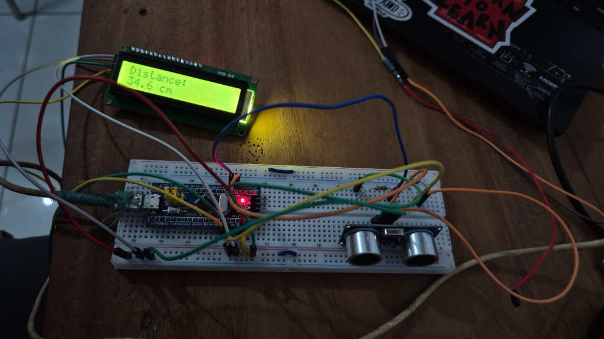
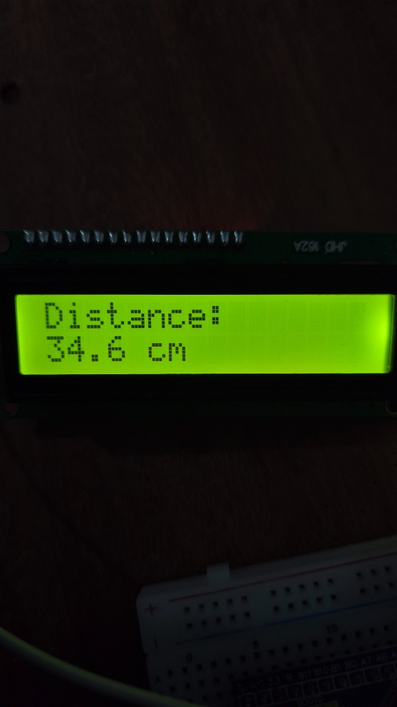
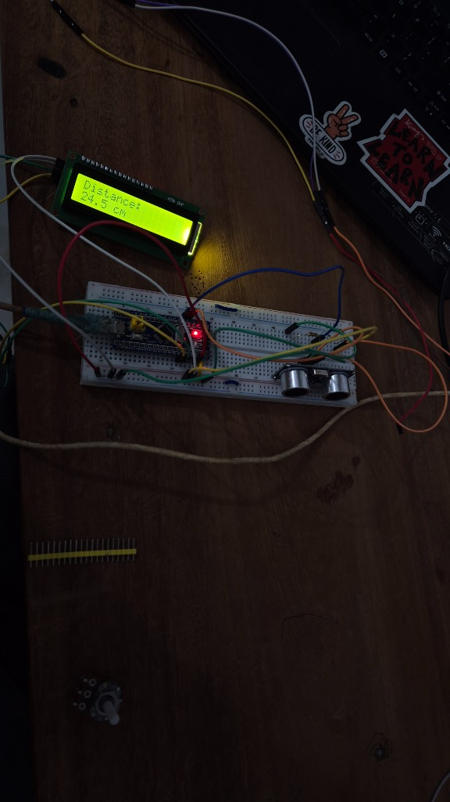

# Ultrasonic Distance Measurement using STM32 Blue Pill & HC-SR04

A complete, high-precision distance measurement project built on the **STM32F103C8T6 (Blue Pill)** microcontroller using the **HC-SR04** ultrasonic sound sensor and an **I2C 16×2 character LCD (JHD162A / HD44780 with PCF8574 backpack)**. Developed and built using **PlatformIO** and the **Arduino (STM32duino)** framework.

---

## 📸 Working Project Demonstration

| Hardware Setup Overview | Live Distance Measurement on 16x2 LCD |
| :---: | :---: |
|  |  |

| Continuous Real-Time Tracking Test |
| :---: |
|  |

---

## 🚀 Features

- **Accurate Distance Ranging:** Measures distances from 2 cm up to 400 cm using high-frequency 40 kHz ultrasonic pulses.
- **Flicker-Free Display:** Second row uses fixed 16-character space padding (`%-16s`), completely avoiding `lcd.clear()` calls that cause distracting screen flickering.
- **Out-of-Range Protection:** Displays `No echo detected` whenever the sensor times out or an object is beyond range, preventing false or stale readings.
- **Hardware-Safe Voltage Divider:** Safely steps down the 5V HC-SR04 ECHO signal to ~2.47V to match the STM32's digital input characteristics.
- **Dual Output:** Outputs live measurements simultaneously to both the 16×2 I2C LCD and the Serial Monitor (115200 baud).
- **Standalone Operation:** Once flashed via ST-Link, the board runs independently from any 5V USB source (phone charger, power bank, PC) without needing ST-Link or a computer.
- **Onboard Heartbeat Indicator:** Toggles the Blue Pill's onboard LED (`PC13`) on each 250 ms measurement cycle.

---

## 🛠️ Components Required

| Component | Quantity | Purpose / Description |
|:---|:---:|:---|
| **STM32F103C8T6 Blue Pill Board** | 1 | 32-bit ARM Cortex-M3 microcontroller (72 MHz) |
| **HC-SR04 Ultrasonic Sensor** | 1 | Ultrasonic transducer module (40 kHz sound waves) |
| **16×2 Character LCD (JHD162A)** | 1 | Visual display with attached PCF8574 I2C backpack |
| **10 kΩ Resistors (1/4W)** | 2 | Voltage divider network for the 5V ECHO output |
| **ST-Link V2 USB Programmer** | 1 | SWD firmware upload and debugging |
| **USB-C Cable** | 1 | 5V power supply to the STM32 Blue Pill board |
| **Solderless Breadboard** | 1 | Circuit assembly |
| **DuPont Jumper Wires** | ~15 | Male-to-Male and Male-to-Female connection wires |

---

## ⚡ Hardware Connections & Pinout

All modules share a **common ground (GND)**. The STM32 board is powered via its **USB-C port**.

### 1. HC-SR04 Ultrasonic Sensor $\rightarrow$ STM32 Blue Pill
| HC-SR04 Pin | STM32 Blue Pill Pin | Description / Notes |
|:---|:---|:---|
| **VCC** | **5V** | Sensor requires 5V supply to power its transducers |
| **GND** | **GND** | Common ground |
| **TRIG** | **PA0** | Digital output from STM32 (10 µs trigger pulse) |
| **ECHO** | **PA1 (via Voltage Divider)** | Stepped down to ~2.47V logic HIGH |

#### 🛡️ ECHO Voltage Divider Schematic
The HC-SR04 ECHO pin produces a 5V output pulse. Because STM32 GPIO pins operate at 3.3V logic, a 2-resistor voltage divider is used to safely reduce the voltage:

```
HC-SR04 ECHO (5V) ───[ 10 kΩ ]───┬───> STM32 PA1 (Input: ~2.47V)
                                  │
                               [ 10 kΩ ]
                                  │
                                 GND
```

- **Calculated Voltage:** $V_{\text{out}} = 5\text{ V} \times \frac{10\text{ k}\Omega}{10\text{ k}\Omega + 10\text{ k}\Omega} \approx 2.5\text{ V}$ (Measured: **2.47 V**).
- **STM32 Input Compatibility:** On the STM32F103 ($V_{DD} = 3.3\text{ V}$), the minimum digital HIGH input voltage ($V_{IH}$) is approximately $2.0\text{ V} - 2.15\text{ V}$. Because $2.47\text{ V} > V_{IH}$, PA1 configured as standard digital `INPUT` reliably detects the logic HIGH echo pulses without risking over-voltage.

---

### 2. 16×2 I2C LCD Backpack $\rightarrow$ STM32 Blue Pill
| LCD Backpack Pin | STM32 Blue Pill Pin | Description / Notes |
|:---|:---|:---|
| **VCC** | **5V** | 16×2 LCD requires 5V for adequate contrast |
| **GND** | **GND** | Common ground |
| **SDA** | **PB7** | Hardware I2C1 Data line |
| **SCL** | **PB6** | Hardware I2C1 Clock line |

> **Contrast Note:** If the LCD lights up but does not show text, gently turn the small blue potentiometer on the back of the I2C backpack using a screwdriver until the characters become crisp and visible.

---

### 3. ST-Link V2 Programmer $\rightarrow$ STM32 Blue Pill
| ST-Link V2 Pin | STM32 Blue Pill Pin | Notes |
|:---|:---|:---|
| **SWDIO** | **PA13** (DIO) | Serial Wire Data Input/Output |
| **SWCLK** | **PA14** (CLK) | Serial Wire Clock |
| **GND** | **GND** | Common ground reference |
| **3.3V / 5V** | **DISCONNECTED** | **Do NOT connect ST-Link power pins**; board is powered via USB-C |

---

### 4. Optional Serial Monitor (USART1)
To view real-time logs on your PC terminal at **115200 baud**:
| USB-to-UART Adapter | STM32 Blue Pill Pin | Description |
|:---|:---|:---|
| **RX** | **PA9 (USART1_TX)** | STM32 transmits debug data to PC |
| **TX** | **PA10 (USART1_RX)** | Optional receive |
| **GND** | **GND** | Common ground |

---

## 💻 Platform & Software Stack

- **Development Platform:** [PlatformIO IDE](https://platformio.org/) (running in Visual Studio Code)
- **Core Platform:** `ststm32` (ST STM32 v20.0.0+)
- **Board Profile:** `bluepill_f103c8` (STM32F103C8T6, 72 MHz ARM Cortex-M3, 64 KB Flash, 20 KB RAM)
- **Framework:** `arduino` (Official STM32duino core)
- **Upload Protocol:** `stlink` (via ST-Link V2 and OpenOCD)
- **Libraries Used:**
  - `marcoschwartz/LiquidCrystal_I2C @ ^1.1.4` (I2C LCD controller)
  - `Wire` (Built-in I2C peripheral driver for STM32)

---

## 📐 How It Works

1. **Triggering Sound Waves:**
   The STM32 sends a clean 10 µs `HIGH` pulse on `PA0` to the HC-SR04 `TRIG` pin. The sensor responds by transmitting an 8-cycle sonic burst at 40 kHz.
2. **Measuring Return Echo:**
   The sensor's `ECHO` pin goes `HIGH` for the duration it takes the sound wave to travel to an object and bounce back. The STM32 measures this duration with `pulseIn(PIN_ECHO, HIGH, 30000)` (30 ms timeout).
3. **Distance Calculation:**
   Using the speed of sound in dry air at room temperature ($\approx 343\text{ m/s} = 0.0343\text{ cm/\mu s}$):
   $$\text{distance\_cm} = \frac{\text{echo\_duration\_us} \times 0.0343}{2.0}$$
4. **Displaying Results:**
   The calculated distance is formatted with one decimal place (`42.5 cm`) and displayed on row 2 of the LCD. If no echo is detected, `No echo detected` is displayed.

---

## 🔧 Building & Flashing

### 1. Prerequisites
- Install [Visual Studio Code](https://code.visualstudio.com/).
- Install the **PlatformIO IDE** extension from the VS Code Extensions marketplace.

### 2. Clone the Repository
```bash
git clone https://github.com/adarshsjc/ultrasonic-sound-sensor_Distance-measure-stm-32.git
cd ultrasonic-sound-sensor_Distance-measure-stm-32
```

### 3. Build Firmware
In PlatformIO, click the **Build** checkmark icon ($\checkmark$) on the status bar, or run:
```bash
pio run
```

### 4. Upload via ST-Link
1. Connect your ST-Link V2 to the STM32 (`SWDIO` $\rightarrow$ `PA13`, `SWCLK` $\rightarrow$ `PA14`, `GND` $\rightarrow$ `GND`).
2. Power the Blue Pill via USB-C.
3. Click the **Upload** arrow icon ($\rightarrow$) on the status bar, or run:
   ```bash
   pio run --target upload
   ```

> [!TIP]
> **If you encounter `Error: init mode failed (unable to connect to the target)`:**
> 1. Move the **`BOOT0` jumper from `0` to `1`**.
> 2. Press the **RESET** button once.
> 3. Click **Upload** again in PlatformIO.
> 4. Once upload completes, move **`BOOT0` back to `0`** and press **RESET**.

---

## 🔌 Standalone Operation

Once flashed, ST-Link and the computer are **no longer required**!
1. Unplug the ST-Link programmer.
2. Confirm both **`BOOT0`** and **`BOOT1`** jumpers are set to **`0`**.
3. Plug any standard 5V USB charger, battery pack, or USB port into the Blue Pill's USB-C port.
4. The system boots immediately and displays continuous distance readings on the LCD.

---

## 📜 License
This project is open-source and available under the [MIT License](LICENSE).
